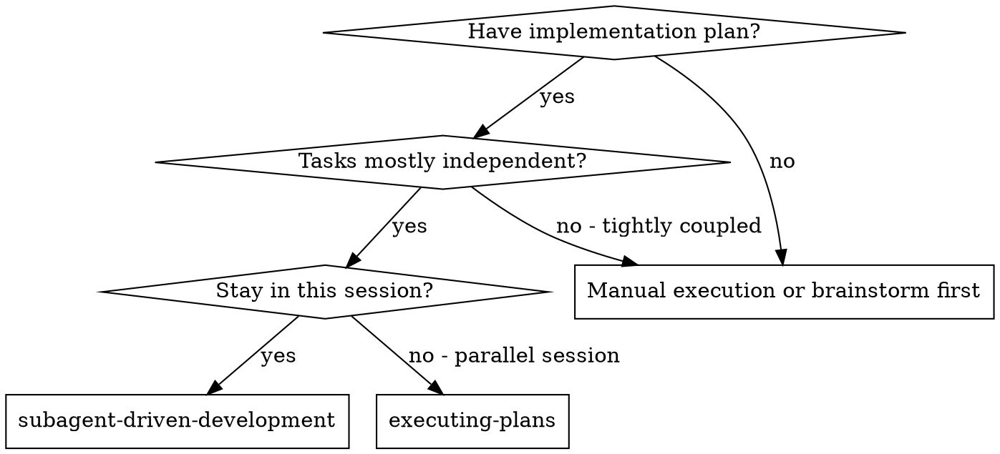

# Subagent-Driven Development

Execute plan by dispatching a fresh implementer subagent per task, a task review (spec compliance + code quality) after each, and a broad whole-branch review at the end.

**Why subagents:** You delegate tasks to specialized agents with isolated context. By precisely crafting their instructions and context, you ensure they stay focused and succeed at their task. They should never inherit your session's context or history — you construct exactly what they need. This also preserves your own context for coordination work.

**Core principle:** Fresh subagent per task + task review (spec + quality) + broad final review = high quality, fast iteration

**Narration:** between tool calls, narrate at most one short line — the
ledger and the tool results carry the record.

**REQUIRED SUB-SKILL:** Use hyperpowers:communication for anything you write to your human partner in this skill: the pre-flight question, an escalation, a BLOCKED hand-back.

**Continuous execution:** Do not pause to check in with your human partner between tasks. Execute all tasks from the plan without stopping. While the plan has tasks left, a turn ends in exactly three cases: a BLOCKED status you cannot resolve; a question only your human partner can answer, asked in that message (ambiguity that genuinely prevents progress is such a question); or, on a harness that cannot wait in the foreground, tracked work still running, named in that message. A message that names your next step is followed by that step's tool call in the same turn. "Tasks 1 and 2 are done. Moving to Task 3." followed by a turn end is a stop: your human partner reads it as work in progress, and nothing resumes it until they type. Completing the last task does not end the plan: it opens the final whole-branch review, and the plan ends only after Finish. Each permitted turn end, and "your human partner asked you to stop", is written to the ledger in the same message that ends the turn: run `scripts/sdd-state handback PLAN_FILE --reason "<why>"` (add `--session <sid>` on a harness without `CLAUDE_CODE_SESSION_ID`; `busy` or `error` is retried, and without the line the guard falls back to reading your last message). Write that line only for a question only your human partner can answer, a BLOCKED report, or their request to stop; finishing the tasks is never a reason for it. On Claude Code the SDD stop guard refuses a turn end it can prove is premature, two consecutive attempts per plan, the count resetting after any allow, with this message: "SDD stop guard: plan <plan path> is not finished (<state>; nothing tracked is live). Take the next step now, in this turn. If you are handing back to your human partner (a question only they can answer, a BLOCKED report, or they asked you to stop), run scripts/sdd-state handback PLAN_FILE --session <sid> --reason "<why>" and end the turn with that message." (with a live job the first sentences name the job and say to watch it with `tracked-job wait`). When you meet it, take the next step; writing a question you do not need answered to get past it is the stop it exists to prevent, and the log records every allow. "Should I continue?" prompts and progress summaries waste their time — they asked you to execute the plan, so execute it.

**Tracked work only:** anything that outlives one tool call starts through your harness's tracked background option (`run_in_background` on Claude Code); never start it with a trailing `&`, `nohup`, `setsid`, `disown`, or a script that detaches a process. The harness never reports on such a process, so nothing wakes you when it ends, and a turn you end to wait for it does not resume.

**After every context compaction:** this file fits within the 20,000 characters Claude Code re-attaches, so the copy you hold is whole. A step file you read before the compaction does not survive it. Before your next action, print the board and the ledger lines the step table names (your task's and your Setup's, never the whole ledger), find your step in the table, and Read that step file in full, along with any other skill you are following whose re-attached copy is cut short.

## When to Use

**vs. Executing Plans (parallel session):**
- Same session (no context switch)
- Fresh subagent per task (no context pollution)
- Review after each task (spec compliance + code quality), broad review at the end
- Faster iteration (no human-in-loop between tasks)

## The Process

Each step's full text is in its own file beside this one. Read a step's file when you enter the step; after a compaction, the step table below names the one to read.

1. **Setup** ([setup.md](setup.md)): sync the state branch and find the plan's workspace, settle where the work happens (hyperpowers:using-git-worktrees), create or read the ledger and append your session line, verify, read the plan and the spec, run the pre-flight scan. Setup's last action appends `session <sid>: setup complete`.
2. **Take a task and dispatch** ([task-loop.md](task-loop.md)): `scripts/sdd-state next` offers a task; claim the first and switch to its branch (none to take, or blocked: post, print the board, hand back). Dispatch the implementer, answer its questions, handle its report.
3. **Review the task** ([review-and-complete.md](review-and-complete.md)): generate the review package and dispatch the task reviewer. Blocking findings go to step 4; a finding that conflicts with the plan text goes to your human partner first.
4. **Fix loop** ([fix-loop.md](fix-loop.md)): fix rounds, each with a scoped re-review, under the shared cap in the rules below. When no finding is left open, go back to review-and-complete.md for the gate.
5. **Codex task gate and completion** ([review-and-complete.md](review-and-complete.md)): unless the task's effective tier is low, run the per-task Codex gate (blocking findings re-enter step 4). Append the `approved` line, merge back, detach, delete the task branch, and run `scripts/sdd-state complete`; any status but `complete` stops. Then step 2.
6. **Final review and Finish** ([final-and-finish.md](final-and-finish.md)): when no task remains, claim the final train, dispatch the final reviewer (one fix dispatch, one scoped re-review), the decision extractor and the Codex final gate, delete the workspace, then use hyperpowers:finishing-a-development-branch.

## After a compaction: the step table

Print the board (`scripts/sdd-state board PLAN_FILE`) and the ledger lines of your task and your Setup (`grep -E '^(Task <N>:|session <sid>: setup complete)' <workspace>/progress.md`, leaving out `Task <N>:` when you hold no task); `scripts/sdd-dir PLAN_FILE` prints the workspace. Do not Read the whole ledger after a compaction: it grows with the plan. A row's newest line is the newest of your task's lines the table names (its branch, base, implementer identity, `report`, `review`, Codex gate round, `approved`, `merged` and `fix round` lines); a line it does not name, such as a deferred minor or the gate directory, leaves your step unchanged. Then Read the step file this table names:

| State | Step file |
|---|---|
| you ran `scripts/sdd-state finish` and it printed `finished`: the workspace is gone, and this row wins over every row below | none: do not run Setup and do not recreate the ledger; continue with hyperpowers:finishing-a-development-branch, from the hand-off message you sent (mode, plan, spec, decision extractor id and notes path, receipt path) |
| no ledger in the workspace, or no `setup complete` line of this session in it | [setup.md](setup.md) |
| the board shows no task held by this session and a task without a completion line | [task-loop.md](task-loop.md) |
| the held task's newest line is its branch, base, implementer identity or `report` line | [task-loop.md](task-loop.md) |
| its newest line is a `review` or Codex gate line approving it, an `approved` line or a `merged` line | [review-and-complete.md](review-and-complete.md) |
| its newest line is a `fix round` line, or a `review` or Codex gate line with blocking findings | [fix-loop.md](fix-loop.md) |
| this session holds the final claim, or every task has a completion line | [final-and-finish.md](final-and-finish.md) |

A state the table does not cover reads [task-loop.md](task-loop.md), and you record that in the ledger.

The table reads these ledger lines, so write each one where its step says:

- `session <sid>: setup complete`, Setup's last action;
- `Task <N>: report <status> <one line>`, after an implementer's report;
- `Task <N>: review <approved|blocking> <reviewer id> <one line>`, after a task review or scoped re-review;
- `Task <N>: codex gate round <R> <approved|blocking> <one line>`, after each per-task Codex gate round.

## Rules for every step

These hold in every step file. Where a step file and this section differ, this section governs.

- Tasks with a `Task <N>: complete` line are DONE — do not re-dispatch them. Conversation memory does not survive compaction. After compaction, trust the ledger and `git log` over your own recollection.
- Dispatch implementer, task-reviewer, fix-round, re-review and final-reviewer subagents with `run_in_background: false`. Your next step always depends on the result, and a foreground call keeps your turn open, which is what an editor such as Zed shows as the session working. A background dispatch ends the turn while the subagent runs, and the editor shows the session idle.
- Run a covering command expected to finish within 10 minutes in the foreground, with an explicit timeout of at least its expected runtime and at most 600000 ms. A command that may run past 10 minutes is a tracked job; [task-loop.md](task-loop.md), "Waiting on subagents and long commands", gives its commands and watch budget.
- One implementer at a time in this session: parallel work is other sessions' (one controller per task branch); never dispatch two implementers at once here.
- Never fix findings yourself in the controller session — your context stays clean for coordination, and controller fixes skip review. The one exception is the de-minimis fix in [fix-loop.md](fix-loop.md).
- The task reviewer's blocking findings and the per-task Codex gate's blocking findings form one loop with ONE shared cap of **five rounds per task**: the gate does not run a count of its own.
- When round 5's re-review — or a per-task Codex gate at the spent cap — still leaves blocking findings open, stop dispatching and surface the task as BLOCKED, as [fix-loop.md](fix-loop.md) describes under the breaker.

## Model Selection

Match the model to the task's difficulty rather than defaulting. Two rules are
defaults you will get wrong by omission, so they stay here: **always specify
the model explicitly when dispatching a subagent** — an omitted model inherits
your session's, usually the most capable and most expensive — and **a mid-tier
model is the floor for reviewers and for implementers working from prose
descriptions**, whatever the schedule pressure. The cheapest tier is for
transcription, where the task's own text carries the complete code to write,
and for single-file mechanical fixes. The per-role guidance, the complexity
signals, and the fix-loop escalation rule are in
[model-selection.md](model-selection.md).

## The waiting board

Before you ask your human partner a question, hand back BLOCKED, meet an
empty frontier (`held` or `blocked`), or stop on a merge conflict, post what
you wait on: `scripts/sdd-state wait PLAN_FILE --session <sid> --kind
<question|tasks|merge|gate|handoff> [--task N] --note "<one line>"`, and put
the session lines of `scripts/sdd-state board PLAN_FILE` in what you write.
When you resume, clear it: `scripts/sdd-state wait PLAN_FILE --session <sid> --clear`.
The board is how your human partner finds the session that needs them among
several; a session that holds a claim and posts nothing shows as quiet
after half an hour, which is where they look for a permission prompt.

## Risk Tiers (per-task Codex gate applicability)

Tiers are `low`, `standard`, `high`, declared per task in the plan. A task
skips the per-task Codex gate only when all three hold: declared low, the
plan's own Codex gate actually reviewed the plan, and no escalation trigger
fired at any point during execution. That skip is recorded durably. An
unreviewed low tier — plan gate skipped, degraded, or outcome unknown —
executes as standard, and a task demoted that way runs the full train and
records NO tier-skip event. The Claude task reviewer and the final
whole-branch train never tier off. When any task did skip, write
`tier-skips.md` in this plan's workspace; Final Review hands its path to the
final reviewer and the final Codex gate. The escalation triggers, the
fallback rules, and the exact ledger line shape are in
[risk-tiers.md](risk-tiers.md) — read it before dispatching any task declared
low.

## Common Rationalizations

The excuses that show up mid-run and what is actually true:
[common-rationalizations.md](common-rationalizations.md). Read it the moment you
catch yourself justifying a shortcut.

## Example Workflow

A complete worked run, dispatch through finish:
[example-workflow.md](example-workflow.md).
