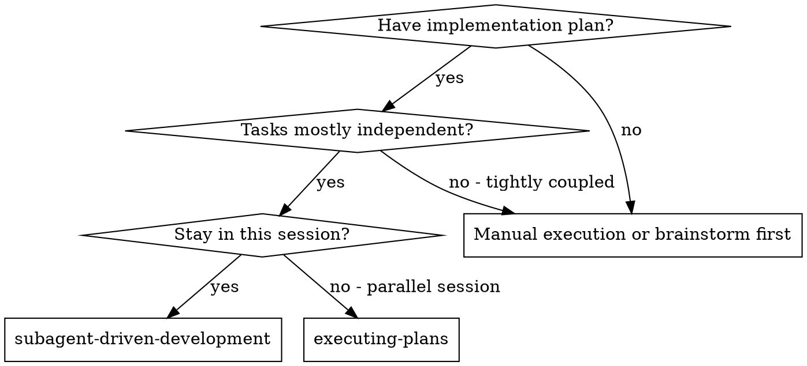
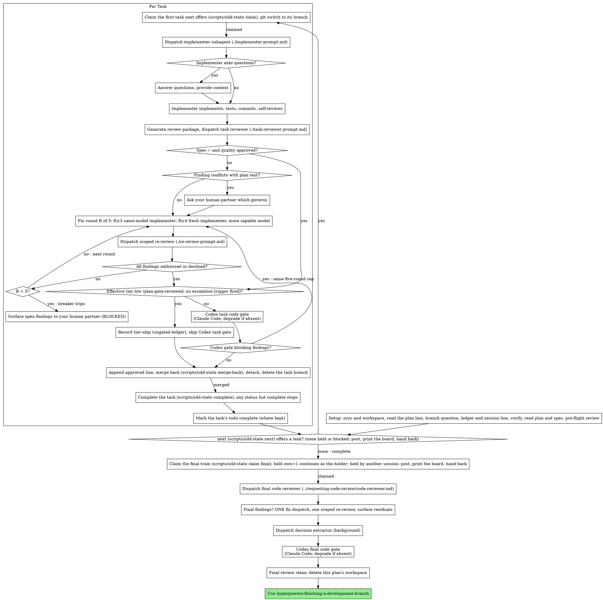

# Subagent-Driven Development

Execute plan by dispatching a fresh implementer subagent per task, a task review (spec compliance + code quality) after each, and a broad whole-branch review at the end.

**Why subagents:** You delegate tasks to specialized agents with isolated context. By precisely crafting their instructions and context, you ensure they stay focused and succeed at their task. They should never inherit your session's context or history — you construct exactly what they need. This also preserves your own context for coordination work.

**Core principle:** Fresh subagent per task + task review (spec + quality) + broad final review = high quality, fast iteration

**Narration:** between tool calls, narrate at most one short line — the
ledger and the tool results carry the record.

**REQUIRED SUB-SKILL:** Use hyperpowers:communication for anything you write to your human partner in this skill: the pre-flight question, an escalation, a BLOCKED hand-back.

**Continuous execution:** Do not pause to check in with your human partner between tasks. Execute all tasks from the plan without stopping. While the plan has tasks left, a turn ends in exactly three cases: a BLOCKED status you cannot resolve; a question only your human partner can answer, asked in that message (ambiguity that genuinely prevents progress is such a question); or, on a harness that cannot wait in the foreground, tracked work still running, named in that message. A message that names your next step is followed by that step's tool call in the same turn. "Tasks 1 and 2 are done. Moving to Task 3." followed by a turn end is a stop: your human partner reads it as work in progress, and nothing resumes it until they type. Completing the last task does not end the plan: it opens the final whole-branch review, and the plan ends only after Finish. Each permitted turn end, and "your human partner asked you to stop", is written to the ledger in the same message that ends the turn: run `scripts/sdd-state handback PLAN_FILE --reason "<why>"` (add `--session <sid>` on a harness without `CLAUDE_CODE_SESSION_ID`; `busy` or `error` is retried, and without the line the guard falls back to reading your last message). Write that line only for a question only your human partner can answer, a BLOCKED report, or their request to stop; finishing the tasks is never a reason for it. On Claude Code the SDD stop guard refuses a turn end it can prove is premature, two consecutive attempts per plan, the count resetting after any allow, with this message: "SDD stop guard: plan <plan path> is not finished (<state>; nothing tracked is live). Take the next step now, in this turn. If you are handing back to your human partner (a question only they can answer, a BLOCKED report, or they asked you to stop), run scripts/sdd-state handback PLAN_FILE --session <sid> --reason "<why>" and end the turn with that message." (with a live job the first sentences name the job and say to watch it with `tracked-job wait`). When you meet it, take the next step; writing a question you do not need answered to get past it is the stop it exists to prevent, and the log records every allow. "Should I continue?" prompts and progress summaries waste their time — they asked you to execute the plan, so execute it.

**Tracked work only:** anything that outlives one tool call starts through your harness's tracked background option (`run_in_background` on Claude Code); never start it with a trailing `&`, `nohup`, `setsid`, `disown`, or a script that detaches a process. The harness never reports on such a process, so nothing wakes you when it ends, and a turn you end to wait for it does not resume.

**After every context compaction:** Claude Code re-attaches this skill cut to its first 20,000 characters, which ends before the task loop, and a full Read you made before the compaction does not survive it. After each compaction, the first and every later one, Read this file in full before your next action (a dispatch, a ledger write, or the finishing steps), then the ledger, along with any other skill you are following whose re-attached copy is cut short.

## When to Use

**vs. Executing Plans (parallel session):**
- Same session (no context switch)
- Fresh subagent per task (no context pollution)
- Review after each task (spec compliance + code quality), broad review at the end
- Faster iteration (no human-in-loop between tasks)

## The Process

## Setup

Setup's full text is in [setup.md](setup.md).

## Model Selection

Match the model to the task's difficulty rather than defaulting. Two rules are
defaults you will get wrong by omission, so they stay here: **always specify
the model explicitly when dispatching a subagent** — an omitted model inherits
your session's, usually the most capable and most expensive — and **a mid-tier
model is the floor for reviewers and for implementers working from prose
descriptions**, whatever the schedule pressure. The cheapest tier is for
transcription, where the task's own text carries the complete code to write,
and for single-file mechanical fixes. The per-role guidance, the complexity
signals, and the fix-loop escalation rule are in
[model-selection.md](model-selection.md).

## The Task Loop

Steps 1 and 2 are in [task-loop.md](task-loop.md); step 3, the per-task Codex gate and step 5 in [review-and-complete.md](review-and-complete.md); step 4 in [fix-loop.md](fix-loop.md).

## The waiting board

Before you ask your human partner a question, hand back BLOCKED, meet an
empty frontier (`held` or `blocked`), or stop on a merge conflict, post what
you wait on: `scripts/sdd-state wait PLAN_FILE --session <sid> --kind
<question|tasks|merge|gate|handoff> [--task N] --note "<one line>"`, and put
the session lines of `scripts/sdd-state board PLAN_FILE` in what you write.
When you resume, clear it: `scripts/sdd-state wait PLAN_FILE --session <sid> --clear`.
The board is how your human partner finds the session that needs them among
several; a session that holds a claim and posts nothing shows as quiet
after half an hour, which is where they look for a permission prompt.

## Risk Tiers (per-task Codex gate applicability)

Tiers are `low`, `standard`, `high`, declared per task in the plan. A task
skips the per-task Codex gate only when all three hold: declared low, the
plan's own Codex gate actually reviewed the plan, and no escalation trigger
fired at any point during execution. That skip is recorded durably. An
unreviewed low tier — plan gate skipped, degraded, or outcome unknown —
executes as standard, and a task demoted that way runs the full train and
records NO tier-skip event. The Claude task reviewer and the final
whole-branch train never tier off. When any task did skip, write
`tier-skips.md` in this plan's workspace; Final Review hands its path to the
final reviewer and the final Codex gate. The escalation triggers, the
fallback rules, and the exact ledger line shape are in
[risk-tiers.md](risk-tiers.md) — read it before dispatching any task declared
low.

## Final Review and Finish

Both are in [final-and-finish.md](final-and-finish.md).

## Common Rationalizations

The excuses that show up mid-run and what is actually true:
[common-rationalizations.md](common-rationalizations.md). Read it the moment you
catch yourself justifying a shortcut.

## Example Workflow

A complete worked run, dispatch through finish:
[example-workflow.md](example-workflow.md).
