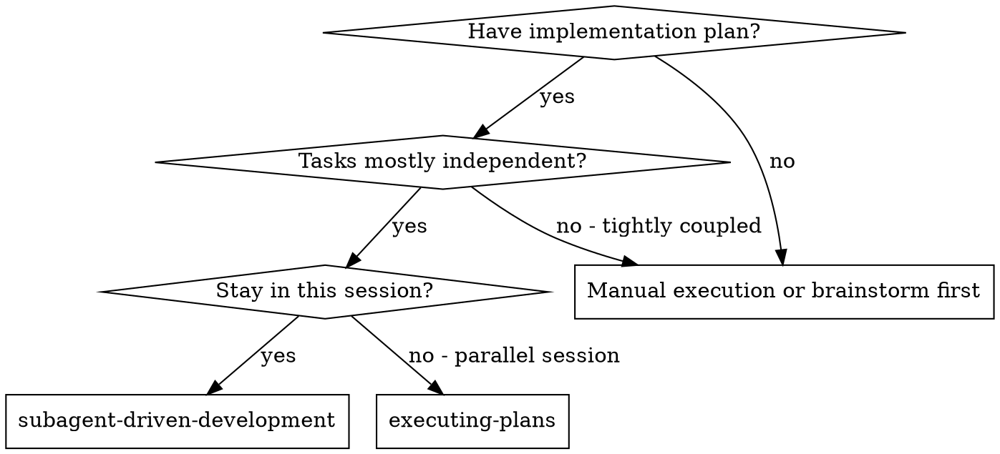
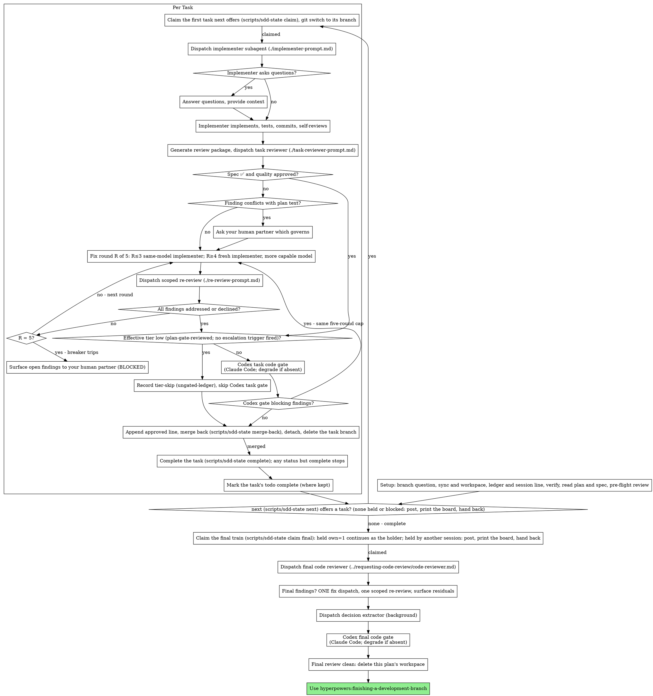

# Subagent-Driven Development

Execute plan by dispatching a fresh implementer subagent per task, a task review (spec compliance + code quality) after each, and a broad whole-branch review at the end.

**Why subagents:** You delegate tasks to specialized agents with isolated context. By precisely crafting their instructions and context, you ensure they stay focused and succeed at their task. They should never inherit your session's context or history — you construct exactly what they need. This also preserves your own context for coordination work.

**Core principle:** Fresh subagent per task + task review (spec + quality) + broad final review = high quality, fast iteration

**Narration:** between tool calls, narrate at most one short line — the
ledger and the tool results carry the record.

**REQUIRED SUB-SKILL:** Use hyperpowers:communication for anything you write to your human partner in this skill: the pre-flight question, an escalation, a BLOCKED hand-back.

**Continuous execution:** Do not pause to check in with your human partner between tasks. Execute all tasks from the plan without stopping. While the plan has tasks left, a turn ends in exactly three cases: a BLOCKED status you cannot resolve; a question only your human partner can answer, asked in that message (ambiguity that genuinely prevents progress is such a question); or, on a harness that cannot wait in the foreground, tracked work still running, named in that message. A message that names your next step is followed by that step's tool call in the same turn. "Tasks 1 and 2 are done. Moving to Task 3." followed by a turn end is a stop: your human partner reads it as work in progress, and nothing resumes it until they type. Completing the last task does not end the plan: it opens the final whole-branch review, and the plan ends only after Finish. Each permitted turn end, and "your human partner asked you to stop", is written to the ledger in the same message that ends the turn: run `scripts/sdd-state handback PLAN_FILE --reason "<why>"` (add `--session <sid>` on a harness without `CLAUDE_CODE_SESSION_ID`; `busy` or `error` is retried, and without the line the guard falls back to reading your last message). Write that line only for a question only your human partner can answer, a BLOCKED report, or their request to stop; finishing the tasks is never a reason for it. On Claude Code the SDD stop guard refuses a turn end it can prove is premature, two consecutive attempts per plan, the count resetting after any allow, with this message: "SDD stop guard: plan <plan path> is not finished (<state>; nothing tracked is live). Take the next step now, in this turn. If you are handing back to your human partner (a question only they can answer, a BLOCKED report, or they asked you to stop), run scripts/sdd-state handback PLAN_FILE --session <sid> --reason "<why>" and end the turn with that message." (with a live job the first sentences name the job and say to watch it with `tracked-job wait`). When you meet it, take the next step; writing a question you do not need answered to get past it is the stop it exists to prevent, and the log records every allow. "Should I continue?" prompts and progress summaries waste their time — they asked you to execute the plan, so execute it.

**Tracked work only:** anything that outlives one tool call starts through your harness's tracked background option (`run_in_background` on Claude Code); never start it with a trailing `&`, `nohup`, `setsid`, `disown`, or a script that detaches a process. The harness never reports on such a process, so nothing wakes you when it ends, and a turn you end to wait for it does not resume.

**After every context compaction:** Claude Code re-attaches this skill cut to its first 20,000 characters, which ends before the task loop, and a full Read you made before the compaction does not survive it. After each compaction, the first and every later one, Read this file in full before your next action (a dispatch, a ledger write, or the finishing steps), then the ledger, along with any other skill you are following whose re-attached copy is cut short.

## When to Use

**vs. Executing Plans (parallel session):**
- Same session (no context switch)
- Fresh subagent per task (no context pollution)
- Review after each task (spec compliance + code quality), broad review at the end
- Faster iteration (no human-in-loop between tasks)

## The Process

## Setup

Settle where the work happens first: use hyperpowers:using-git-worktrees,
which detects an existing worktree or asks your human partner to choose
between staying on the current branch, a new branch in place, and a
worktree, and reports the mode. Never start implementation on a main/master
branch unless your human partner chose "stay on the current branch" in that
question; that answer is the consent, and the dossier no longer depends on
the branch.

Conversation memory does not survive compaction. In real sessions,
controllers that lost their place have re-dispatched entire completed task
sequences — the single most expensive failure observed. Track progress in
a ledger file, not only in todos.

- Each plan owns a workspace: at skill start, run `scripts/sdd-state sync PLAN_FILE`
  (it fetches the repository's state branch; outcomes below), then this
  skill's `scripts/sdd-dir PLAN_FILE` — it prints the plan's workspace
  inside the repository's state checkout under the user cache
  (`${XDG_CACHE_HOME:-~/.cache}/hyperpowers/state/<key>/plans/<plan-slug>-<hash8>/`,
  one checkout per clone, shared by every worktree of it), home to every
  artifact for THIS plan: ledger, briefs, reports, review packages, claims,
  tier-skip summary. The ledger, reports, notes and claims are committed to
  the orphan branch `hyperpowers/state` by `scripts/sdd-state snapshot PLAN_FILE`
  and travel between hosts with that branch; briefs and review packages are
  ignored there and regenerate. The cache is off any protected path, so
  writing there never triggers a permission prompt, and it is outside the
  working tree, so it can never be committed with the code. Another plan's
  directory is never yours to read or write. When `sdd-dir` reports
  `backend=plain` on stderr, the state branch is unavailable on this host
  and the dossier will not travel from it: tell your human partner once and
  continue.
- `sdd-state sync` outcomes: `up-to-date`, `fast-forwarded`, `merged`,
  `ahead`, `created`, `absent`, `no-remote`, `assumed-absent`, `plain`:
  continue. `offline` (exit 1): continue on the local checkout and, as soon
  as the ledger exists (the next bullet), append
  `state: sync offline at <time>` to it. `offline-no-state` (exit 1), or
  `needs-sync` from `sdd-dir`: stop; this host has no dossier and cannot
  learn whether the remote holds one. Ask your human partner to get online,
  or to confirm `scripts/sdd-state sync --assume-absent PLAN_FILE` when they
  know no remote dossier exists. `diverged` (exit 3): stop and present both
  tips and the printed `merge=` command as a question in the Deciding
  Together shape; never merge on your own. `busy` (exit 3): retry `sync`
  once after the other session's writes settle, then ask.
  `foreign` (exit 2): the branch at the state name is not a hyperpowers
  state branch; stop, relay the stderr remedy (set git config
  `hyperpowers.stateBranch` to another name), and ask.
  `remote-finished plans=<ws,...>` (exit 3): another host finished a plan
  whose workspace on this host holds ledger lines that are not on the
  branch. When the list names this plan's workspace, stop, show your human
  partner the lines this host added (the ledger's tail beyond the last
  snapshot), and ask whether to snapshot them (then `sync` again, which
  reports `diverged` for their merge) or to discard them. A workspace in
  the list that is not this plan's belongs to another plan: report its
  name and stop without reading or changing it.
  Any other status, `status=error` (exit 2) among them, stops the run until
  `sync` succeeds; show its stderr line.
- Check for this plan's ledger at `<workspace>/progress.md` — this plan's
  workspace only, never a sibling's. The workspace is the plan's identity:
  `scripts/sdd-dir` maps a plan to ONE directory whatever path form you
  hand it, so a ledger sitting in YOUR workspace is this plan's progress
  even when its first line records the path in another form. Compare
  repo-relative paths: reduce the plan you were handed to its path relative
  to the plan repository's toplevel; a line holding an absolute path matches
  when it lies inside this repository and reduces to the same relative path,
  or, when it names a path that does not exist on this host (a ledger
  written on another machine), when it ends with that relative path. Tasks
  with a `Task <N>: complete` line are
  DONE — do not re-dispatch them; resume at the first task without one. A
  task whose last line is a fix round is mid-loop: resume the loop at the
  next round. A task whose last line is its implementer identity is a
  dispatch in flight: do not re-dispatch — reconcile that agent first
  (list your live children, chase its report), resume it by the recorded
  id where your harness allows, and only if it cannot be recovered
  dispatch a takeover, recording the takeover's identity beside the
  original. The scan only reads: every action it calls for (a resume, a
  takeover, the next task) waits until `verify` below has returned `ok`.
  A first line that resolves to a genuinely different plan
  file means this workspace is corrupt, not that you wandered into a
  sibling's: stop and surface it to your human partner rather than
  starting fresh on top of another plan's state.
- When there is no ledger, create it with its identity as the first line,
  `# SDD ledger — plan: <repo-relative plan path>` (never an absolute path:
  the ledger travels between hosts), through a no-clobber write so two
  sessions that both saw no ledger cannot overwrite each other:
  `( set -o noclobber; printf '# SDD ledger — plan: %s\n' <repo-relative plan path> > <workspace>/progress.md )`.
  When that write fails because the file now exists, another session
  created it first: continue as if you had found it. Whether you created
  it or found one, append your session line (with `>>`, never a rewrite):
  `session <sid>: mode <current-branch|new-branch|worktree> on <task branch or detached> integrating <integration branch> at <toplevel> started <UTC time>`,
  where `<sid>` is `$CLAUDE_CODE_SESSION_ID` on Claude Code and, on a harness
  without one, a value you generate once as `$(date -u +%s)-$RANDOM$RANDOM`,
  and the mode is what using-git-worktrees reported. Append a fresh session
  line whenever you move to a new task branch or detach; your newest line is
  your location. When your human partner assigned this session specific
  tasks, add `session <sid>: tasks <N,M,...>`. Then, once registered (the
  next bullet), run `scripts/sdd-state verify PLAN_FILE` (on a found ledger
  this is the check that this host holds the code it relies on): `ok` continues;
  anything else stops Setup until `verify` passes again. `code-missing`
  names commits the ledger relies on that this checkout lacks, so ask your
  human partner to pull the named branch; `wrong-repo` names the repository
  the ledger was handed off from, so ask which checkout this work belongs
  in; `plan-stale` names the plan repository branch to pull, and you read
  the plan again after that pull.
- Register the plan before anything else is claimed:
  `scripts/sdd-state register PLAN_FILE --session <sid> --integration <branch>`,
  where `<branch>` is the branch the branch choice produced (the plan's
  integration branch; later sessions read it from the ledger's plan line and
  pass the same). `registered` continues; `wrong-branch` means this plan is
  already running on another integration branch: switch to it or ask;
  `spec-branch-mismatch` means a sibling plan of this spec runs on another
  branch: use that branch; `branch-closing` means the plan's branch is being
  merged and deleted: wait for your human partner; `detached-head` (exit 11)
  means a first registration found the repository the line names on a
  detached HEAD, as a host-managed workspace can be, and the plan ref is
  named after a branch: ask your human partner for the branch to create
  (the integration branch itself when plan and code share one repository),
  create it in place with `git -C <the repository the line names> switch -c <name>`,
  and register again. Any other status stops Setup until `register`
  succeeds; show its stderr line. A later session of a
  running plan starts its worktree detached at the integration head
  (using-git-worktrees says how) and never checks the integration branch
  out; a later session (the ledger already has a plan line naming the
  integration branch) that is not already detached at that branch's head
  runs `git switch --detach <branch>` before `register`, whatever mode
  using-git-worktrees reported (an existing worktree, a native tool's
  worktree, or work in place); a worktree that skill created detached is
  already there. Before that detach, and before any claim, a later session
  compares `git rev-parse --show-toplevel` with the `at <toplevel>` of every
  other session's newest session line: a match means you are inside another
  session's worktree (a native tool can resume one under the same name), so
  do not detach, switch or claim there. Leave it, create your own worktree
  with a name that carries your session id (using-git-worktrees, Detaching a
  later session), append a fresh session line from it, and detach that one.
  When the plan file lives in another repository
  than the code, pass `--code-repo <code toplevel>` to every `sdd-state`
  call; an omitted option means the current repository, and a wrong one is
  `wrong-repo`.
- Quote the graph in the ledger: run `scripts/sdd-state deps PLAN_FILE` and
  append its lines after the scan table. The scan's conflict rows include
  `scripts/sdd-state deps --check PLAN_FILE --ledger <workspace>/progress.md`'s
  lines: each `conflict tasks=A,B ...` is a row for your human partner, settled
  by an amendment (`scripts/sdd-state amend PLAN_FILE --from <edited copy>
  --base <plan= blob> --message <subject>`, with `--accept 'tasks=A,B path=
'`
  when they accept the overlap; the edited copy is a file outside the
  checkout's plan path, a copy in the plan's workspace, never the checked-out
  plan file itself, which `amend` refuses) and never by editing the plan in
  the worktree alone, because the plan ref is what every session reads.
- The ledger is your recovery map: the commits it names exist in git even
  when your context no longer remembers creating them. After compaction,
  trust the ledger and `git log` over your own recollection.
- The workspace is scratch for the working tree and a record on the branch:
  the Finish step removes the plan's directory through
  `scripts/sdd-state finish PLAN_FILE --session <sid>`, and the branch history keeps it, so
  an evidence note can cite `git show <sha>:plans/<ws>/<file>`. Nothing
  inside the checkout is reclaimed automatically; `scripts/sdd-state prune --repo <dir>`
  lists and removes idle plan directories only when asked. Snapshot the
  workspace (`scripts/sdd-state snapshot PLAN_FILE`) after the pre-flight
  scan table and before the final review; `scripts/sdd-state complete`
  snapshots after every completion line it writes, so a hand-off or a crash
  loses at most the task in flight. The completion's durable record is the
  snapshot `complete` takes, so that helper's status line decides whether
  you go on: `status=complete` continues, `busy` and `error` are retried,
  and every other status stops. A snapshot you run by hand answers
  `snapshot` (or `plain`, where no state branch exists), which continues;
  `none` means what you just wrote is not in the workspace the helper sees,
  and `error` (exit 2) means the commit or the ref update failed; both stop
  until the snapshot succeeds.
  When your human partner asks to
  hand the run to another host, run `scripts/sdd-state handoff PLAN_FILE --push`
  (the only time the state branch is pushed, never on your own initiative),
  report its status line, relay `plan-not-committed` with the commands to
  commit the plan, relay `code-dirty` with the listed paths as a question
  (only an explicit yes passes `--code-dirty-ok`), relay `detached-head`
  by asking for a branch name and creating it in the repository the line
  names (`repo=code` or `repo=plan`: `git -C <that repository> switch -c <name>`)
  before retrying, relay `shallow-source` (exit 12) the same way (a full
  clone, or `git -C <that repository> fetch --unshallow`, since a shallow
  code or plan repository cannot record a root), and stop on `plain`
  (exit 7: this host has no state branch, so there is no dossier to push),
  `scan-failed` (exit 5: the pre-push scan named in `hyperpowers.prePushScan`
  rejected the range; show its output and ask) and `push-failed` (exit 1:
  the remote moved or could not be reached; run `sync` first, then retry):
  none of them is a hand-off, so report nothing as ready to pull.
  `snapshot ... push=none` (exit 0) is no hand-off either: the plan
  repository has no remote, so the record is committed on this host and
  nothing left it; report it as a local snapshot and ask your human partner
  for a remote if the dossier has to travel. On
  `pushed`, list the branches named in `code=` and, when present, `plan=`
  for your human partner to push here and pull there. You push none of
  them unless asked.

Read the plan once, note its context and Global Constraints, and create a
todo per task where your harness surfaces todos — the ledger is the
progress record either way; todos mirror it, never replace it. Read the
plan's `**Spec:**` header and the spec file it names: the spec is the
binding authority the plan argues from, and conflicts inside the plan
resolve against it. A plan whose spec is `none` or unreachable gets a
ledger line saying so — without a spec, a conflict has no tiebreaker but
your human partner.

When the plan has a spec, dry-run the decision compiler over it now:
`bash <finishing skill's directory>/scripts/decisions-compile <spec> --dry-run`
(the finishing-a-development-branch skill, `../finishing-a-development-branch/`
relative to this one). Exit 0 confirms the spec's `## Decisions` list parses;
its numbered listing goes into the ledger under a `Decisions listing:` line
for the extractor's dispatch. Exit 2 for a missing list is the legacy-spec
case: draft the list from the spec's own text, one item per decision it
states, show it to your human partner, and write it into the spec once they
approve it, committing that edit on the branch. Any other exit 2 names what
to fix first (a spec that is not committed, or a `Supersedes:` problem) to
resolve with them the same way. After any repair, run the dry run again
until it exits 0, and only then write its numbered listing into the ledger.
The session is at its start, so this costs no cycle time. When the plan has
no spec (`none`, or unreachable, per the ledger line above), write
`Decisions: none (no spec)` in the ledger and skip the listing, the
extractor and the spec in the hand-off: finishing then takes its test-only
path.

Before dispatching Task 1, scan the plan once for conflicts, writing down
what you checked as you check it:

- tasks that contradict each other or the plan's Global Constraints
- anything the plan explicitly mandates that the review rubric treats as a
  defect (a test that asserts nothing, verbatim duplication of a logic block)

The scan's output is a table, not a verdict. One row for every pair of tasks
that share a file or an interface: the two tasks, what one produces against
what the other consumes, and what you found. One row for every task: whether
its own text agrees with itself — the tests it specifies against the code it
specifies, the files it creates against the files it later touches. "The scan
is clean" without those rows is not a scan you ran.

Write the table to the ledger. Then present everything it surfaced to your
human partner as ONE batched question — each finding beside the plan text
that mandates it, asking which governs — before execution begins, not one
interrupt per discovery mid-plan. Each finding is a decision with
consequences downstream, so it gets the shape the brainstorming skill's
Deciding Together section describes: the conflict and what each resolution
costs in chat, then the selection widget to collect the answers. If the scan
is clean, proceed without comment. The review loop remains the net for
conflicts that only emerge from implementation.

## Model Selection

Match the model to the task's difficulty rather than defaulting. Two rules are
defaults you will get wrong by omission, so they stay here: **always specify
the model explicitly when dispatching a subagent** — an omitted model inherits
your session's, usually the most capable and most expensive — and **a mid-tier
model is the floor for reviewers and for implementers working from prose
descriptions**, whatever the schedule pressure. The cheapest tier is for
transcription, where the task's own text carries the complete code to write,
and for single-file mechanical fixes. The per-role guidance, the complexity
signals, and the fix-loop escalation rule are in
[model-selection.md](model-selection.md).

## The Task Loop

**Batch small same-shape work.** When the plan lists several tasks that are
each a small, independent edit of the same kind — the same one-line fix,
constant change, or field addition repeated across files — do not dispatch
one subagent per task. Compose ONE dispatch brief listing every file and
its change, send the whole batch to a single subagent, and review its diff
as one unit. Reserve one-dispatch-per-task for work that needs its own
judgment, its own tests, or its own review surface.
A batch's effective risk tier for the per-task Codex gate is the MAX of the
batched tasks' declared tiers — batching low-tier tasks never manufactures
a gate skip.

Everything you paste into a dispatch prompt — and everything a subagent
prints back — stays resident in your context for the rest of the session
and is re-read on every later turn. Hand artifacts over as files.

**Waiting on subagents and long commands.** On Claude Code, wait in the foreground:

- Dispatch implementer, task-reviewer, fix-round, re-review and final-reviewer subagents with `run_in_background: false`. Your next step always depends on the result, and a foreground call keeps your turn open, which is what an editor such as Zed shows as the session working. A background dispatch ends the turn while the subagent runs, and the editor shows the session idle.
- Run a covering command expected to finish within 10 minutes in the foreground, with an explicit timeout of at least its expected runtime and at most 600000 ms.
- A command that may run past 10 minutes is a tracked job. Allocate it in the foreground with `scripts/tracked-job new PLAN_FILE <name> --budget-ms <budget>` (the watch budget below; the helper writes the `jobdir=` line in the ledger itself), launch `scripts/tracked-job run <jobdir> -- <command>` through the tracked background option with the budget as its timeout, then watch it in the foreground with repeated `scripts/tracked-job wait <jobdir> --max-ms 600000` calls: `exited code=0` is success; any other `exited` code is a failed command, handled as that command's failure (a failed test is a fix round, a failed covering command a failed task); `running` at the bound means another `wait`; on `lost`, run `tracked-job stop <jobdir>` first and read its answer before you go on: only `stopped` or `not-running` means the survivors are swept and the job can be treated as failed (a process in the job's group that carried no fence is left alone and counted as `skipped` in `<jobdir>/meta.json`, and one that outlived the KILL is counted in `survivors`; report a nonzero `survivors` or `skipped`, or a record you cannot read, to your human partner with the jobdir and pgid before you go on, and never call that job stopped); `busy` means the lock was held and nothing was swept, so run `stop` again; `status=error` means the job directory could not be read, so escalate it to your human partner naming the jobdir and leave the job live; `lost-unswept pgid=<n>` means the sweep needs a shell that can list processes and read their identity (the sandbox cannot), so the job stays live to the stop guard until `tracked-job stop <jobdir>` runs where it can: report it to your human partner with its pgid beside the failure, and expect a reused pid to read as `running` until that sweep. When you need a job's output, write the tail of its `out.log` to `<workspace>/reports/job-<name>.txt` and cite the path; output never goes in the ledger. A background shell you start in a turn without `tracked-job` is live work no job record names: end the turn while one is still running and the stop guard refuses that turn end as `live-shell`. Codex reviews already follow this shape through the recipe's `status <job-id> --wait --json` loop.
- **Watch budget.** The total watch on one job is three times the plan's stated runtime for it, or 60 minutes when the plan states none, capped at the harness's maximum background lifetime (7200000 ms on Claude Code). The watch ends when `wait` reports `exited`, `lost` or `lost-unswept`; a supervisor the harness killed writes no exit file, and `wait` reports it as `lost`. When the budget is spent with the job still running, run `tracked-job stop <jobdir>` and read its answer before you end the turn: `stopped` or `not-running` means the job is over, so write the `out.log` tail to `<workspace>/reports/job-<name>.txt` and report BLOCKED naming that path (a nonzero `survivors` or `skipped` in `<jobdir>/meta.json`, or a record you cannot read, is reported the same way, with the jobdir and pgid, and that job is never called stopped); `busy` means the workspace lock was held and nothing changed, so run `stop` again; `stop-timeout` means the supervisor has not concluded the job, so run `stop` again, three calls in all, and escalate a third one to your human partner as a job still live, naming the jobdir; `status=error` means the job directory could not be read, so escalate it the same way, naming the jobdir; `lost-unswept pgid=<n>` leaves the job live, so report it to your human partner as still live with its pgid, never as stopped.

On a harness whose subagents run asynchronously, never poll a wait interface with short timeouts, and never sit in one silent, open-ended wait either. While you have local work — ledger updates, packaging the next review, reading reports — keep working; child results arrive on their own. When you are genuinely idle, wait in bounded stretches (five to ten minutes, where your platform allows), and between stretches post one line of status and reconcile your live children: list them, and chase any that finished without reporting. A bounded stretch keeps nearly all of a long wait's efficiency while guaranteeing a stuck or lost child is noticed within minutes, not at the end of the session. Codex's `wait_agent` blocks inside the turn; `using-hyperpowers/references/codex-tools.md` maps it.

### 1. Dispatch the implementer

Record BASE right after `git switch <branch>` and before dispatching, as the
task branch's fork point from the integration branch:
`git merge-base HEAD refs/heads/<integration branch>` (the full ref name, so
a tag with the branch's name cannot be read instead). On a fresh claim that
is the claim's `from=` commit. On a takeover it is the original claim's base,
or, once the conflict route has merged the integration branch into the task
branch, the integration head merged in; the previous holder's commits stay in
the review package and the fix-round diffs either way, which both need BASE.
A HEAD read before the claim can lag the integration branch while other
sessions merge.

- **Task brief:** before dispatching an implementer, run this skill's
  `scripts/task-brief PLAN_FILE N` — it extracts the task's full text to a
  uniquely named file and prints `wrote <path>: <N> lines`. Take the path
  from that line; do not paste the line itself into a dispatch. Compose the
  dispatch so the
  brief stays the single source of
  requirements. Your dispatch should contain: (1) one line on where this
  task fits in the project; (2) the brief path, introduced as "read this
  first — it is your requirements, with the exact values to use verbatim";
  (3) interfaces and decisions from earlier tasks that the brief cannot
  know; (4) your resolution of any ambiguity you noticed in the brief;
  (5) the report-file path and report contract. Exact values (numbers,
  magic strings, signatures, test cases) appear only in the brief. Never
  make a subagent read the whole plan file.
- **Report file:** name the implementer's report file after the brief
  (brief `…/task-N-brief.md` → report `…/task-N-report.md`) and put it in
  the dispatch prompt. The implementer writes the full report there and
  returns only status, commits, a one-line test summary, and concerns.
- A dispatch prompt describes one task, not the session's history. Do not
  paste accumulated prior-task summaries ("state after Tasks 1-3") into
  later dispatches — a real session's dispatch hit 42k chars of which 99%
  was pasted history. A fresh subagent needs its task, the interfaces it
  touches, and the global constraints. Nothing else.
- The dispatch carries the no-subagents contract (it is in the
  implementer template): the implementer never dispatches subagents —
  not helpers, and never a reviewer. Review arrives from you, after the
  report. In real sessions, every reviewer a worker spawned duplicated
  the task review the controller dispatched anyway — a full extra
  review seat per task.
- Subagents follow hyperpowers:test-driven-development for the task's tests.
- If an earlier task deferred a finding in the area this task touches — a
  Minor in the ledger, or one your human partner decided — carry a pointer
  to that ledger entry in the dispatch.
- Ask what to take: `scripts/sdd-state next PLAN_FILE --session <sid>`.
  `status=next tasks=<list>` names the claimable tasks in plan order, this
  session's own claims first; claim the first:
  `scripts/sdd-state claim PLAN_FILE N --session <sid>`. `claimed` prints the
  task branch and its base: check the branch out (`git switch <branch>`) and
  dispatch on it; `held` with your own session id (`own=1`, a resume after
  compaction) prints the same two fields: check the branch out and proceed;
  `held` with `own=1` and `merged=1` means the task is already merged and its
  branch deleted: check nothing out and resume it at its completion line
  (Complete the task, below); `claimed` with `takeover=1` and `merged=1`
  means the same after a takeover: the task is already merged, so check
  nothing out, dispatch nothing, and resume it at its completion line (the
  previous holder's task branch may still exist; you do not need it);
  `held` from `claim` after `next` offered the task is a race lost, run
  `next` again; `blocked` means the plan moved under you, run `next` again.
  A task held by another session is ordinary while next offers another: take
  what it offers. When `next` prints `status=none reason=<reason>`:
  `complete` goes to the final train (Finish below); `assigned-complete` is
  reported and the session hands back; `held` and `blocked` mean post a
  waiting record (`scripts/sdd-state wait PLAN_FILE --session <sid> --kind
  tasks --note "<the held= and waiting= fields>"`), print
  `scripts/sdd-state board PLAN_FILE`, and hand back with the board's session
  lines in your message. Take a held task over only on your human partner's
  explicit yes to a question that names the holder and the time since
  (`--takeover`), recording the takeover beside the original identity;
  `own-blocked` means an amendment put a prerequisite under your own claim:
  post, print the board, hand back, and let your human partner remove the
  edge or let the prerequisite complete. `done`, `no-workspace` and `error`
  keep their handling: `done`: another session completed the task since you
  read the ledger; read its completion line, mark the task done, and never
  dispatch it. `no-workspace` (exit 2): the workspace is gone (finished or
  pruned elsewhere); stop, run `sync`, and re-read the ledger before
  anything else. `error` (exit 2, the same exit as `no-workspace` and a
  different problem): a read or a write failed, so the task is not claimed
  and `sync` is not the answer; stop and show the stderr line. Any other
  status stops the dispatch until `claim` succeeds; show its stderr line.
- Record the implementer's agent identity from the dispatch result in the
  ledger's task entry
  (`Task <N>: implementer <agent-id-or-name> (model <model>, session <sid>, worktree <path>, branch <name>)`) —
  fix-loop rounds 1-3 resume this agent where the harness has no foreground
  dispatch and dispatch on its recorded model where it does, and after compaction the ledger is
  the only place the identity survives once its agent has exited. An
  identity that was never written down forces a fresh takeover where a
  resume was owed.
- When another session may be live on this plan, append ledger lines with a
  quoted heredoc (`cat >> <workspace>/progress.md <<'EOF'`), never with the
  Edit tool, whose read-modify-write drops a line another session appended
  in between.
- One implementer at a time in this session: parallel work is other sessions' (one controller per task branch); never dispatch two implementers at once here.
- Where the Agent tool offers `run_in_background`, dispatch with it false; where it does not (fork mode in an interactive terminal), dispatches run in the background and the stop guard treats them as live work.

Template: [implementer-prompt.md](implementer-prompt.md)

### 2. Handle the report

**Subagent Reports Are Claims.** Subagent reports are claims, not
evidence. Before acting on any completed-status report (DONE or DONE_WITH_CONCERNS) or a fix report —
dispatching the reviewer, re-running a gate, marking a task complete — the
controller re-runs the named covering test command directly and compares
the output against the report. A misreported result is a failed task:
re-dispatch with the discrepancy named, not a bookkeeping correction.

Every implementer and fix dispatch names either its covering test
command(s) or an explicit `no covering command: <rationale>` line plus the
controller's substitute verification (read the diff against the brief;
render or grep the changed doc). A dispatch naming neither is malformed —
fix the dispatch, not the rule.

A covering command must be able to fail. One that can no-op on the state
under test — a changed-files linter on a clean tree, a test filter that
matches nothing — is not covering evidence, however honestly it exits 0.
Name the files or the test ids explicitly so the command exercises what
the report claims.

Implementer subagents report one of four statuses. Handle each appropriately:

**DONE:** Generate the review package (`scripts/review-package PLAN_FILE BASE HEAD`, from this skill's directory — it prints `wrote <path>: <N> commit(s), <N> bytes`, so take the path from that line; BASE is the commit you recorded before dispatching the implementer — never `HEAD~1`, which silently drops all but the last commit of a multi-commit task). If `review-package` exits non-zero, read its stderr and fix the range before dispatching — exit 2 means bad inputs (wrong argument count, a missing plan file, a ref that does not resolve) or an ancestry check git itself could not answer (a missing or corrupt object); exit 3 means BASE..HEAD is empty or HEAD is not a descendant of BASE, usually a wrong-branch commit; never dispatch a reviewer without a package. Otherwise, dispatch the task reviewer with the path.

**DONE_WITH_CONCERNS:** The implementer completed the work but flagged doubts. Read the concerns before proceeding. If the concerns are about correctness or scope, address them before review. If they're observations (e.g., "this file is getting large"), note them and proceed to review.

**NEEDS_CONTEXT:** The implementer needs information that wasn't provided. Provide the missing context and re-dispatch.

**BLOCKED:** The implementer cannot complete the task. Assess the blocker:
1. If it's a context problem, provide more context and re-dispatch with the same model
2. If the task requires more reasoning, re-dispatch with a more capable model
3. If the task is too large, break it into smaller pieces
4. If the plan itself is wrong, stop and escalate to your human partner — the plan text, what it breaks, and the correction you would make

**Never** ignore an escalation or force the same model to retry without changes. If the implementer said it's stuck, something needs to change.

If the implementer asks questions — before starting or mid-task — answer
clearly and completely, provide additional context if needed, and don't
rush it into implementation.

### 3. Review the task

Per-task reviews are task-scoped gates. The broad review happens once, at the
final whole-branch review. Never skip the task review, and never accept a
report missing either verdict — spec compliance AND task quality are both
required. Implementer self-review never replaces the task review; both are
needed. Note the task's effective risk tier as you go (see Risk Tiers,
below) — the Claude task review always runs, but the tier decides whether
step 4's per-task Codex gate does.

- Hand the reviewer its diff as a file: run this skill's
  `scripts/review-package PLAN_FILE BASE HEAD` — it prints
  `wrote <path>: <N> commit(s), <N> bytes`, so take the path from that line
  and pass it to the reviewer (or, without bash: `git log --oneline`,
  `git diff --stat`, and `git diff -U10` for the range, redirected to one
  uniquely named file). The output never enters your own context, and the reviewer sees
  the commit list, stat summary, and full diff with context in one Read
  call. Use the BASE you recorded before dispatching the implementer —
  never `HEAD~1`, which silently truncates multi-commit tasks. Never
  dispatch a task reviewer without a diff file.
- **Reviewer inputs:** the task reviewer gets three paths — the same brief
  file, the report file, and the review package — plus the global
  constraints that bind the task. Write those global constraints to a small
  file alongside the brief and report: the per-task Codex gate takes the
  same file as its global-constraints handoff.
- The global-constraints block you hand the reviewer is its attention
  lens. Copy the binding requirements verbatim from the plan's Global
  Constraints section or the spec: exact values, exact formats, and the
  stated relationships between components ("same layout as X", "matches
  Y"). The reviewer's template already carries the process rules (YAGNI,
  test hygiene, review method) — the constraints block is for what THIS
  project's spec demands.
- Do not add open-ended directives like "check all uses" or "run race tests
  if useful" without a concrete, task-specific reason
- Do not ask a reviewer to re-run tests the implementer already ran on the
  same code — the implementer's report carries the test evidence
- Do not pre-judge findings for the reviewer — never instruct a reviewer to
  ignore or not flag a specific issue. If you believe a finding would be a
  false positive, let the reviewer raise it and adjudicate it in the review
  loop. If the prompt you are writing contains "do not flag," "don't treat X
  as a defect," "at most Minor," or "the plan chose" — stop: you are
  pre-judging, usually to spare yourself a review loop. When the plan supplies
  example code, weaknesses in that code are fair review targets — the example
  was a starting point, not evidence that its weaknesses were chosen.
The task reviewer may report "⚠️ Cannot verify from diff" items — requirements
that live in unchanged code or span tasks. These do not block the rest of the
review, but you must resolve each one yourself before marking the task
complete: you hold the plan and cross-task context the reviewer
lacks. If you confirm an item is a real gap, treat it as a failed spec
review — it enters the fix loop with the other findings.

Template: [task-reviewer-prompt.md](task-reviewer-prompt.md)

### 4. The fix loop

The loop triggers when the review reports spec ❌, any Critical or Important
finding, a ⚠️ item you confirmed as a real gap, or a blocking finding from
the per-task Codex gate below.

Task-reviewer findings are claims too. The fixing implementer verifies
each finding against the code before fixing it
(hyperpowers:receiving-code-review); a finding is declined only as
refuted or corrected with file:line evidence, which the controller
records in the ledger; a confirmed finding is fixed or carried open; a
finding nobody can settle stays open and counts against the round cap.

Before the loop starts, two routes leave it immediately:

- Record Minor findings in the progress ledger as you go
  (`Task <N>: minor (deferred): <one-liner>`), and point the final
  whole-branch review at that list so it can triage which must be fixed
  before merge. A roll-up nobody reads is a silent discard. Minor findings
  never enter the loop.
- A finding labeled plan-mandated — or any finding that conflicts with what
  the plan's text requires — is your human partner's decision: present the
  finding and the plan text beside it and ask which governs. Do not dismiss
  the finding because the plan mandates it, and do not dispatch a fix that
  contradicts the plan without asking.

Everything else enters the loop — the Claude task reviewer's blocking
findings and the per-task Codex gate's blocking findings alike. They are ONE
loop with ONE shared cap of **five rounds per task**: the gate does not run
a count of its own. A fix round is one fix dispatch — or one
controller-applied de-minimis fix — plus one scoped re-review.

**Rounds 1-3 — the same model, carrying the task's record.** Where the Agent
tool offers `run_in_background` (Claude Code outside fork mode), dispatch a
fresh implementer in the foreground (`run_in_background: false`) with the
brief path, the report-file path, and the open findings verbatim, on the
original implementer's model (the `model` in its ledger identity line);
tell it a prior implementer did the
task and the report file records what it did and tried. A foreground
dispatch keeps your turn open until the fix returns, so a fix round on
Claude Code dispatches a fresh foreground implementer; a SendMessage resume
is for harnesses without the option, Claude Code's fork mode among them. On
those harnesses, resume the original
implementer with the findings verbatim: its context is intact. If the
harness cannot message a live subagent either, dispatch a fresh implementer
with the brief path, the report-file path, and the findings; the report file
is the persistent memory either way.

**Rounds 4-5 — dispatch a fresh takeover implementer on a more capable
model** (per Model Selection), with the brief path, the report-file path,
the open findings, and this framing: "A prior implementer attempted this
task [N] times; you own it now. Read the report file for what was tried." A
loop that survives three rounds usually means the same model cannot see
its own problem: the takeover brings a more capable one.

**Every round, either way:** the implementer fixes, re-runs the tests
covering the amended code, appends its fix report to the same report file,
and returns the short contract. Before re-dispatching the reviewer, confirm
the fix report contains the covering tests, the command run, and the
output; dispatch the re-review once all three are present. That
precondition covers the findings the round fixed; a round that declines
every finding is defined below. Name the covering test files in the fix
message — a one-line fix does not need the whole suite. The per-task loop
gives a fix round to an implementer rather than a fixer, so it never uses
[fix-subagent-prompt.md](fix-subagent-prompt.md) — that template belongs to
the final review's one fix wave.

**The re-review is scoped.** Run `scripts/review-package PLAN_FILE FIX_BASE HEAD`
where FIX_BASE is the head the previous review saw, and dispatch
[re-review-prompt.md](re-review-prompt.md) with the findings list, the
brief, the report file, and the printed diff path. The re-reviewer verdicts
each finding ADDRESSED, NOT ADDRESSED, or DECLINED — a refuted or corrected
finding whose file:line evidence the re-reviewer has confirmed; an unconfirmed
decline stays NOT ADDRESSED — and flags new breakage in the fix diff only. The
controller records each DECLINED finding in the ledger with its evidence. New
Critical/Important breakage in the fix diff joins the open findings list.
Out-of-scope observations go to the ledger as deferred minors — they never
extend the loop. Every round in this loop ends with the scoped re-review —
never a full task-reviewer re-run, whatever the finding's origin.

**A round that declines every finding changes no code.** There is no fix
diff and no covering test to confirm; the implementer's report is the
artifact, carrying for each finding the refuted or corrected evidence at
file:line. Skip `scripts/review-package` for that round — its range is
empty — and dispatch the scoped re-review with the findings list, the brief,
the report, and the previous review's package path, so the re-reviewer
verdicts each finding DECLINED or NOT ADDRESSED from the evidence alone. The
covering-tests precondition applies only to findings that were fixed. Record
the round as `(0 addressed, <Y> declined, <Z> open)`; a NOT ADDRESSED verdict
keeps that finding open and the round counts toward the cap as usual.

**After each round,** append to the ledger:
`Task <N>: fix round <R>/5 (<X> addressed, <Y> declined, <Z> open — <finding one-liners>; commits <a7>..<b7>)`

Never fix findings yourself in the controller session — your context stays
clean for coordination, and controller fixes skip review. One narrow
exception: a fix fully specified by the finding itself — exact file, exact
lines, exact replacement, no judgment left — touching at most 3 lines in
one file with no new logic, may be controller-applied — one finding per
reach; a round holding two such findings is not de minimis. The exception
waives nothing else: it consumes a fix round and ends in the same scoped
re-review; the controller applies the edit and runs the fix's covering
command FIRST — a failure means the fix was not de minimis: revert the
edit, spend no round, and go back to the round's own rule — then commits
the verified fix (the re-review packages committed diffs — an
uncommitted fix hands it nothing) and appends the fix report — the
command, its output, and a diff summary — to the task's report file
itself, exactly as an implementer would. Its ledger line keeps the
fix-round schema with the marker inside it:
`Task <N>: fix round <R>/5 controller-applied (de minimis) (<X> addressed, <Y> declined, <Z> open — <finding one-liners>; commits <a7>..<b7>)`.
Reaching for it twice in the same task means the findings are not de
minimis — go back to the round's own rule: hand the findings to an
implementer at rounds 1-3, dispatch the takeover at rounds 4-5.

**Codex Review Gate (Claude Code only).** When running under Claude Code, add
a Codex **code** review gate at two points — here, per task, and once more
at the final whole-branch review — following
[../requesting-code-review/codex-review-gate.md](../requesting-code-review/codex-review-gate.md).
Probe once per skill run and reuse the result; if Codex is absent, emit the
no-Codex notice once and run both gates as no-ops.

- **Per task:** after the task reviewer approves (spec ✅ and quality approved) and
  before marking the task complete, run the gate (standard/high effective tiers; an effective-low task skips it per Risk Tiers below, recording the tier-skip event instead) using the per-task code recipe
  with `--base <the task BASE you recorded before dispatching the implementer>`.
  Provide the task brief path, implementer report path, review-package path, and
  the global-constraints file you wrote in step 3. The gate's dossier `--adjudications` inputs carry the plan's `**Spec:**` file path beside any spec-gate ledger, so the reviewer is handed the binding authority instead of inferring it.
- **Rounds are shared, not stacked.** Blocking findings from this gate enter
  the same five-round loop above, at the next round number — the gate has no
  separate Codex ceiling of its own. The task's fix-round budget is five,
  shared across Claude-reviewer rounds and Codex-gate rounds. Three mechanics
  keep that single budget honest:

  1. **One `GATE_DIR` for this task's whole gate lifecycle.** Create it at
     the task's first gate invocation and reuse that same dir for every
     Codex re-round of this task — the gate doc's §3 contract, "Use one
     `GATE_DIR` for the whole gate." `gate-round`'s counter lives in that
     dir, so it counts exactly this task's gate rounds and nothing else.
     When the `GATE_DIR` is first created, record it in the progress ledger
     as one line `Task N gate dir: <path>`; on resume (or any later Codex
     re-round), reuse the ledgered path instead of creating a new one; if
     the ledgered dir no longer exists (cache purged), treat the task's
     prior gate rounds as unknown and fail closed: do not assume zero —
     reconstruct the consumed-round count from the ledger's fix-round
     entries and, if gate rounds cannot be established, surface via BLOCKED
     rather than restarting the count.
  2. **Let the counter do the arithmetic.** `gate-round` compares its LOCAL
     count — gate rounds only, monotonic within the `GATE_DIR` — against a
     ceiling, so the ceiling must leave gate rounds out; they are already in
     that count. Pass `--consumed <NON-gate fix rounds this task has consumed
     so far>` (all fix/re-review rounds, whatever the finding's origin — the
     gate's own invocation rounds are excluded only because `gate-round`'s
     counter already holds them) and the script derives the ceiling from the
     shared five-round cap itself. Recompute the consumed count at each call:
     non-gate rounds may land between gate rounds. Do not hand-compute
     `--ceiling` for a task gate — that is how twenty measured task gates
     recorded ceilings of 1, 2, 6, and 7, two of which the cap makes
     impossible. `--consumed` cannot express them.
  3. **A spent cap is BLOCKED, not a gate round.** When the task's consumed
     rounds already total five, `--consumed 5` yields a ceiling of zero and
     the gate backstops on its first call. That is the fail-closed floor, not
     the intended path: check before calling, and when the cap is spent follow
     the breaker below and surface the task as BLOCKED rather than spending a
     gate invocation to learn it.

  The invariant in one line: **local gate rounds + non-gate fix rounds ≤ 5**,
  enforced because `gate-round` blocks (verdict `backstop`) the moment its
  local count would exceed the ceiling. Count every round the
  gate runs against the task's shared budget — each gate round consumes one
  of the five, exactly like a reviewer round. After a Codex-triggered fix,
  the scoped re-review verifies it; the gate re-runs only once that
  re-review verdicts every finding ADDRESSED or DECLINED.

**The breaker.** When round 5's re-review — or a per-task Codex gate at the
spent cap — still leaves blocking findings open, stop dispatching. The task
does not silently continue and nothing is parked on your own authority:
surface the open findings to your human partner as BLOCKED, each with the
rounds already spent, what was tried, and the evidence. Ledger it:
`Task <N>: BLOCKED at cap — <finding one-liners>`. They decide what happens
next.

### 5. Complete the task

When the review comes back clean — the task reviewer approved, every
fix-loop finding is addressed or declined, and the per-task Codex gate
approved or was skipped by tier — in this order, each step idempotent on a
resume:

- Append `Task <N>: approved <full id>` with the head the reviewers saw,
  written with `git rev-parse <head>` (every later approval of the same task
  appends a new line; the newest is what merges). merge-back compares the
  whole id, so a shortened id reads as no approval.
- Merge back: `scripts/sdd-state merge-back PLAN_FILE N --session <sid> --commit <sha>`.
  `merged` continues (`already=1` on a resume means the ref was moved
  before the crash). `conflict paths=<list>`: merge the integration branch
  into the task branch in your worktree (`git merge <integration>`), resolve
  through one implementer dispatch whose brief names the paths and both
  sides, re-run the task reviewer over the resolution and the task gate's
  re-review lens, append the new `approved` line, and retry. `checked-out`
  names a worktree or `lease:<sid>`: a final train holds the branch; post a
  `tasks` record and retry after it ends, or ask your human partner to move
  the checkout. `not-approved approved=<sha7|none>` means your bookkeeping
  is behind: the commit you passed is not the task's newest `approved` line,
  so append the `approved` line for the head the reviewers saw (or pass that
  head) and retry. `blocked waiting=<list>` (exit 7) means an amendment put a
  prerequisite under your claim after you took it, and merge-back enforces
  the edge: leave the `approved` line as it is, and never write a completion
  line for a task this session did not complete. Run `next` and take what it
  offers; on `own-blocked`, post, print the board and hand back as the
  `own-blocked` text above says. Retry merge-back once every waiting task has
  its completion line, or after your human partner removes the edge.
  `not-holder owner=<sid>` (exit 4)
  means the claim is no longer yours (after a takeover your human partner
  granted, that session holds it): stop and hand back with the line; never
  repair the ledger or take the claim back.
- Detach at the merged head and drop the task branch:
  `git switch --detach <merged head>` then `git branch -d <task branch>`
  (its commits are on the integration branch now; a missing branch on a
  resume is fine). If `-d` refuses, the branch holds commits that were never
  approved or merged: keep it, do not force the delete, and hand back to
  your human partner with git's output.
- Complete the task: run `scripts/sdd-state complete PLAN_FILE N
  --commits <base7>..<head7>` and repeat it until it prints `status=complete`
  (`busy` and `error` are retried; `unknown-task` means the number is not a
  heading in the plan, `no-workspace` that the ledger is gone, and a usage
  error that the arguments are wrong: each of those stops you, not the loop).
  Its `snapshot=` is the completion's durable record.
- Mark the todo complete (where you keep todos), and run `next`.

A task whose ledger has a `merged` line and no completion line is resumed
at the completion line, never redispatched.

## The waiting board

Before you ask your human partner a question, hand back BLOCKED, meet an
empty frontier (`held` or `blocked`), or stop on a merge conflict, post what
you wait on: `scripts/sdd-state wait PLAN_FILE --session <sid> --kind
<question|tasks|merge|gate|handoff> [--task N] --note "<one line>"`, and put
the session lines of `scripts/sdd-state board PLAN_FILE` in what you write.
When you resume, clear it: `scripts/sdd-state wait PLAN_FILE --session <sid> --clear`.
The board is how your human partner finds the session that needs them among
several; a session that holds a claim and posts nothing shows as quiet
after half an hour, which is where they look for a permission prompt.

## Risk Tiers (per-task Codex gate applicability)

Tiers are `low`, `standard`, `high`, declared per task in the plan. A task
skips the per-task Codex gate only when all three hold: declared low, the
plan's own Codex gate actually reviewed the plan, and no escalation trigger
fired at any point during execution. That skip is recorded durably. An
unreviewed low tier — plan gate skipped, degraded, or outcome unknown —
executes as standard, and a task demoted that way runs the full train and
records NO tier-skip event. The Claude task reviewer and the final
whole-branch train never tier off. When any task did skip, write
`tier-skips.md` in this plan's workspace; Final Review hands its path to the
final reviewer and the final Codex gate. The escalation triggers, the
fallback rules, and the exact ledger line shape are in
[risk-tiers.md](risk-tiers.md) — read it before dispatching any task declared
low.

## Final Review

The final train is claimed. When `next` says `complete`, run
`scripts/sdd-state claim PLAN_FILE final --session <sid>`: `claimed` means
this session runs the final review, the final gate and Finish; `blocked`
names tasks still open (claims without completion lines elsewhere: wait or
ask); `held` with your own session id (`own=1`, a resume after compaction)
means this session already holds the train: continue as its holder; `held`
names the session that holds it, or `lease=<sid> plan=<ws>`
when a sibling plan's final holds the branch: post a `tasks` record naming
the holder, print the board, and hand back. The holder checks the
integration branch out in its own worktree (`git switch <integration>`), the
one time a session does so, and runs the review package, the final
reviewer, the fix wave and the final Codex gate on it; its fix commits land
on the integration branch directly, which the lease makes safe.

Once you hold the train and have checked the integration branch out, the
final whole-branch review gets a package too: run
`scripts/review-package PLAN_FILE MERGE_BASE HEAD` (MERGE_BASE = the commit the
branch started from, e.g. `git merge-base main HEAD`) — take the path from the
`wrote <path>: ...` line and include it in the final review dispatch, so the
final reviewer reads one file instead of re-deriving the branch diff with git
commands. Dispatch
on the most capable available model (see Model Selection), using
hyperpowers:requesting-code-review's
[code-reviewer.md](../requesting-code-review/code-reviewer.md). Point it at
the ledger's deferred-minor lines — and at `tier-skips.md`, if any task
skipped its per-task gate — so it can triage which must be fixed before
merge.

If the final whole-branch review returns findings, dispatch ONE fix subagent
with the complete findings list — not one fixer per finding. Compose the
dispatch from [fix-subagent-prompt.md](fix-subagent-prompt.md).
Per-finding fixers each rebuild context and re-run suites; a real
session's final-review fix wave cost more than all its tasks combined.
Then run exactly one scoped re-review of the fix wave
(`scripts/review-package PLAN_FILE FIX_BASE HEAD` over the fix range,
[re-review-prompt.md](re-review-prompt.md) using its Final-wave usage note).
There is no second fix wave: anything the re-review leaves open — and any
finding that conflicts with the plan's text — goes to your human partner
with the evidence, as BLOCKED, when finishing-a-development-branch presents
the options.

**Dispatch the decision extractor.** When the ledger has a `Decisions listing:`
line (and otherwise nothing), once the fix wave and its re-review are
clean (or the final review returned no findings), take a scratch directory
from `../requesting-code-review/scripts/codex-review-dir`, regenerate the
full-branch package (`scripts/review-package PLAN_FILE MERGE_BASE HEAD`, so a
fix wave's commits are in it) and copy it and `<workspace>/progress.md` into
it, and dispatch the
extractor in the background, composed from
`../finishing-a-development-branch/decision-notes-prompt.md` with those two
copies, the plan, the spec, the `Decisions listing:` from the ledger, the
index (`decisions/README.md` beside the spec's directory) when it exists, and
`<dir>/decision-notes.md` as its output path. Record it in the ledger:
`Decision extractor: <task id> -> <dir>/decision-notes.md`. The dispatch is
complete only when that line is in the ledger: write it before any other tool
call, because after a compaction it is the only record of the task id and the
notes path, and without it a resumed controller can neither collect nor stop
the extractor. The extractor reads nothing inside the workspace, so Finish may
delete the workspace while it runs;
finishing-a-development-branch collects it after the full suite and never
waits for it, and neither do you. On a harness with no tracked background
subagent, skip the dispatch and note it in the ledger. If a Codex final-gate
fix changes code after the dispatch: stop the extractor (TaskStop); when the
fix altered one of the spec's decisions, settle that first (show your human
partner the change you would write into the `## Decisions` item, write and
commit it on the branch with their approval; without it the item stands and
the change is raised again at the menu); re-run the dry run and replace the
ledger's `Decisions listing:`; regenerate the full-branch package and copy
it, with the current `<workspace>/progress.md`, into the scratch directory,
replacing the earlier copies; compose the replacement dispatch from those
copies; then dispatch the extractor again and replace the
`Decision extractor:` line.

**Codex Review Gate — final whole-branch (Claude Code only).** After the final code-reviewer
subagent and its fix wave, and before hyperpowers:finishing-a-development-branch,
run the gate using the final whole-branch code recipe with `--base <branch
merge-base, e.g. git merge-base main HEAD>`. Provide the branch
review-package path, plan or requirements path, the Minor findings ledger if
present, and the tier-skip summary if any task skipped. The final dossier passes the plan's `**Spec:**` file as a `--doc` input beside the plan, and carries the tier-skip summary among its `--adjudications`. Resolve blocking
findings with one fix subagent carrying the complete list, per this
section's existing guidance, before finishing. After any Codex-triggered
final-review fix, re-run the final code-reviewer before re-running the final
Codex gate.

Unlike the per-task gate, the final gate keeps a ceiling of its own: the
gate's convergence stop-rule and per-gate backstop bound this loop (code
gates use a code-gate backstop of 3 rounds). If the backstop is hit with
unresolved blocking findings, surface them to your human partner rather than
looping.

## Finish

When the final whole-branch review is clean and its fixes are merged:

1. **Read your session line** from the ledger (its `mode`), and copy the
   ledger's `Decisions listing:` and `Decision extractor:` lines (or its
   skip reason) into the hand-off message you are about to send: the next
   step removes the ledger from the working tree, and
   hyperpowers:finishing-a-development-branch takes the mode, the plan, the
   spec and the extractor's task id and output path as its input.
2. **Finish the workspace** with `scripts/sdd-state finish PLAN_FILE --session <sid>`:
   it refuses with `open-claims` while any claimed task lacks a completion line
   (that is a plan not finished, not a reason for `--force`), and with
   `busy` (exit 3) when another session is writing the workspace or a copy
   from an interrupted removal sits beside it (report the stderr line, wait
   for the other session or ask your human partner about the copy, then run
   `finish` again); it also refuses with `live-jobs` while a tracked job it
   names is still live (run `tracked-job wait` on it, or `tracked-job stop`
   when the job is no longer wanted, then run `finish` again). `not-holder`
   or `no-final-claim` (exit 11): this session does not hold the final
   train; stop and hand back. Otherwise it
   removes the plan's directory, commits the removal to the state branch,
   and prints `last=<sha>`, the commit that still holds the dossier,
   `push=<remote>/<branch>` and `receipt=<path>`, the durable copy of the
   ledger, the guard's log and the job records; record the receipt path in
   your closing message. A line reading `receipt=none staging=<path>` means
   the record exists only under that staging path: name the path to your
   human partner in the closing message. A space in either path prints as
   `%20`, so decode it before you name the path. On the plain backend it
   prints `backend=plain` instead of `last=` and `push=`, and there is
   nothing to push. `none` means there was no workspace to remove, and
   `error` (exit 2) that the removal or its commit failed: any status other
   than `finished` stops Finish until the command
   succeeds; show its stderr line.
3. **Verify deletion** with `test ! -d "<workspace>"` to confirm it is gone.
   The push command is `git -C <checkout> push <remote> <branch>`, the
   checkout being the parent of the `plans/` directory `sdd-dir` printed;
   run it only if your human partner asks.
4. **Keep the lease through the branch action.** `finish` leaves the branch
   lease in place; hyperpowers:finishing-a-development-branch marks the
   branch closing before a merge and releases the lease after whichever
   option your human partner chose. Hand it the plan path and your session
   id for that. When the final ends with a hand-back instead, detach your
   worktree first (`git switch --detach`) and then release the lease
   yourself, as the last action:
   `scripts/sdd-state lease PLAN_FILE --release --session <sid>`.

A clean finish that leaves the workspace behind is an INCOMPLETE finish —
"keeping it for reference" is not an option; the repo's commits are the
durable record. Sibling directories belong to other plans; leave them
alone. `scripts/sdd-state prune --repo <dir>` is the only other remover, and it
runs only when asked.

Use hyperpowers:finishing-a-development-branch, passing the mode from your
session line. Hand it the plan and the spec, and the extractor's task id
and output path when one was dispatched; when the dispatch was skipped,
hand over the ledger's reason instead and say so, and finishing compiles
without notes; when the plan has no spec, say that, and finishing runs its
test-only path. A decision a Codex-gate fix altered was settled in Final
Review before the re-dispatch.

## Common Rationalizations

The excuses that show up mid-run and what is actually true:
[common-rationalizations.md](common-rationalizations.md). Read it the moment you
catch yourself justifying a shortcut.

## Example Workflow

A complete worked run, dispatch through finish:
[example-workflow.md](example-workflow.md).
